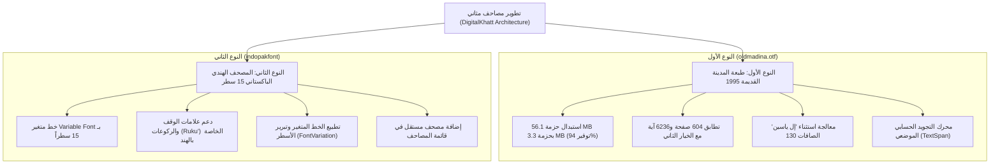
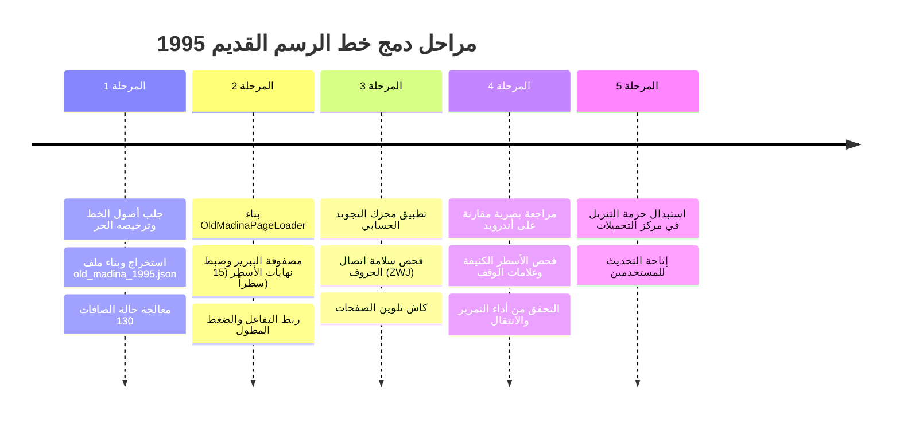
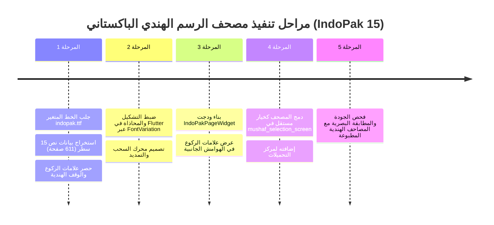

# الخطة التنفيذية لدمج خطوط DigitalKhatt في مثاني
## (الرسم القديم 1995 + الرسم الهندي الباكستاني 15 سطر)

**المشروع:** مثاني (Mathani)  
**التاريخ:** 19 نوفمبر 2026  
**الهدف:** وضع خطة عمل هندسية ومواصفات فنية متكاملة لتنفيذ نوعين من المصاحف في تطبيق مثاني باستخدام تقنيات الخط الواحد المتقدمة من مشروع DigitalKhatt:
1. **النوع الأول:** خط طبعة المدينة النبوية القديمة لعام 1995 (`oldmadina.otf`) كبديل فائق الكفاءة للخيار الثاني (الرسم القديم).
2. **النوع الثاني:** خط الرسم الهندي الباكستاني المتغير (`indopakfont`) المخصص لمصحف 15 سطراً.

---

---

# الجزء الأول: خط الرسم القديم 1995 (`oldmadina.otf`)
## (بديل الخيار الثاني القائم)

### 1.1 الجدوى التقنية ومقارنة الأثر
- **الوضع الحالي (الخيار الثاني):** يعتمد على تنزيل **56.1 ميغابايت** موزعة على مئات ملفات الخطوط وقواعد البيانات (خط لكل صفحة أو جداول جليف معقدة).
- **الوضع المقترح (DigitalKhatt Old Madina):**
  - ملف خط موحد واحد: `oldmadina.otf` بحجم **1.73 MB** (أو WOFF2 بحجم 0.53 MB).
  - ملف بيانات نصية وتوزيع أسطر: نحو **1.6 MB**.
  - **الحجم الإجمالي:** نحو **3.3 MB** فقط (تخفيض حجم التنزيل بنسبة **94%**، واستهلاك شبه منعدم لموارد التخزين والذاكرة المؤقتة).
- **المطابقة التخطيطية:**
  - 604 صفحات كاملة، 15 سطراً لكل صفحة.
  - مطابقة تامة لنهايات جميع الآيات الـ 6236 سطراً وصفحة مع مصحف المدينة القديم المطبوع.

---

### 1.2 معالجة الفروق النصية والاستثناءات
- **حالة سورة الصافات الآية 130:**
  - في طبعة المدينة القديمة رُسمت: `سَلَـٰمٌ عَلَىٰٓ إِلْ يَاسِينَ` مفصولة، بينما في بعض المصادر الرقمية تُدمج ككلمة واحدة `إِلْيَاسِينَ`.
  - **الإجراء:** إدراج معالجة صريحة في محول البيانات (`OldMadinaTextAdapter`) لضمان تقسيم الكلمات بهوية ثابتة:
    - كلمة 1: `سَلَـٰمٌ`
    - كلمة 2: `عَلَىٰٓ`
    - كلمة 3: `إِلْ`
    - كلمة 4: `يَاسِينَ`
  - يضمن هذا عدم انزياح فهارس الكلمات عند الضغط المطول أو التسميع أو البحث أو التفسير.

---

### 1.3 تلوين أحكام التجويد الحسابي (Algorithmic Tajweed Engine)
- **فلسفة العمل:** ملف الخط `oldmadina.otf` خالٍ من ألوان الخطوط الثابتة (Font Color Tables). العارض يقوم بحساب مواضع أحكام التجويد على النص المجرد، ثم يلوّن الحروف برمجياً عبر `TextSpan`.
- **التحدي الهندسي:** في اللغة العربية، تجزئة الكلمة الواحدة إلى عدة `TextSpan` بألوان مختلفة قد يؤدي في محركات الرسم (HarfBuzz / Skia) إلى كسر ترابط الحروف (Broken Cursive Joining) أو اختلال مواضع الحركات.
- **الحل المعتمد:**
  1. استخدام فواصل الربط الصفري (Zero-Width Joiner `\u200D` - ZWJ) عند حدود التلوين داخل الكلمة الواحدة للحفاظ على ترابط الحرف مع سابقه ولاحقه.
  2. عزل الحركات والشدات لتتبع الحرف المنطوق دون إزاحة بصرية.
  3. حصر ألوان التجويد في 5 مجموعات قياسية:
     - **الأزرق (المدود):** مد واجب، متصل، منفصل، لازم (4-6 حركات).
     - **الأخضر (الغنن):** الإخفاء، الإدغام بغنة، النون والميم المشددتان.
     - **البرتقالي/الأحمر (القلقلة):** قطب جد.
     - **الرمادي (الحروف غير المنطوقة):** همزة الوصل، اللام الشمسية، حروف العلة المسقطة وصلاً.
     - **النيلي/الأزرق الفاتح (الإقلاب):** الميم الصغيرة.

---

### 1.4 مراحل خطة التنفيذ للنوع الأول

#### خطة المهام التفصيلية:
1. **المرحلة 1: البيانات والأصول**
   - تنزيل `oldmadina.otf` وحفظه في `assets/fonts/old_madina/`.
   - كتابة سكربت تحويل نص DigitalKhatt إلى JSON منظم بالصفحات والأسطر والكلمات.
   - التحقق الآلي من تطابق نهاية كل آية (صفحة وسطر) مع المرجع المطبوع بنسبة 100%.
2. **المرحلة 2: خدمة العرض والمحاذاة**
   - بناء ودجت `OldMadinaMushafPageWidget` مستلهم من معمارية الخيار الرابع الناجحة.
   - ضبط معامل التمدد والتبرير (Justification Factor) لكل سطر ليملأ الصفحة بدقة كالمصحف المطبوع.
   - التحقق من ضبط علامات الوقف وأرقام الآيات.
3. **المرحلة 3: محرك التجويد التفاعلي**
   - كتابة كود `TajweedRuleParser` لمعالجة أحكام التجويد وإرجاع قائمة `TextSpan` ملونة.
   - اختبار اتصال الحروف عند تلوين النون المخفاة والمدود والقلقلة.
   - إضافة مفتاح تشغيل/إيقاف تلوين التجويد في إعدادات القراءة.
4. **المرحلة 4: الفحص والاعتماد**
   - فحص بصري على شاشات مختلفة الأحجام والكثافات.
   - مقارنة عينات لصفحات كثيفة: سورة الأعراف (ص 151-176)، والشعراء، والصفحة 604 (المعوذتان والإخلاص).
   - اختبار سرعة فتح الصفحة (يجب ألا يتجاوز 16ms لكل صفحة).

---

# الجزء الثاني: خط الرسم الهندي الباكستاني المتغير (`indopakfont`)
## (مصحف 15 سطراً المعتمد في شبه القارة الهندية)

### 2.1 ما هو خط IndoPak المتغير وخصائصه؟
- **الهدف:** إضافة مصحف برسم القارة الهندية (Indo-Pak / Nastaliq-Naskh hybrid) لخدمة شريحة واسعة من المسلمين في باكستان والهند وبنغلاديش وآسيا، الذين يصعب عليهم قراءة الرسم العثماني الشامي/المدني.
- **الخط المستخدم:** خط حر مفتوح المصدر مطور من DigitalKhatt (`indopakfont`) بصيغة **Variable Font**، تم تصميمه خصيصاً لمصحف الـ 15 سطراً.
- **أهمية الخط المتغير (Variable Font):**
  - في مصحف IndoPak 15 سطر التقليدي، يتم تبرير الأسطر عبر مد الحروف وتغيير عرضها (Kashida / Width / Weight variations) بدقة بالغة حتى ينتهي كل سطر بكلمة كاملة، وتنتهي كل صفحة بآية كاملة (Ayah-ending format).
  - يوفر الخط المتغير محاور تحكم برمجية (Axes) تسمح لـ Flutter بتمديد أو تقليص السطر بصرياً ليملأ عرض الصفحة تماماً دون تشويه ميكانيكي.

---

### 2.2 الخصائص الفريدة لمصحف 15 سطر الهندي
1. **عدد الصفحات:** عادة **611 صفحة** (يبدأ من الفاتحة ص 1 وينتهي بالناس ص 611)، وجميع صفحاته تنتهي بفاصلة آية.
2. **علامات الوقف الهندية:** تختلف عن المصاحف العربية:
   - `ط`: وقف مطلق (يقابل قلى).
   - `ج`: وقف جائز.
   - `ز`: وقف مجوز.
   - `ص`: وقف مرخص.
   - `لا`: لا تقف.
   - `قف`: أمر بالوقف.
   - `صل`: قد يوصل.
3. **علامات الركوع (`ع`):** 
   - تميز المصاحف الهندية بوجود رموز الركوع في الهوامش مع 3 أرقام (رقم الركوع في السورة، عدد الآيات في الركوع، ورقم الركوع في الجزء).
4. **طريقة ضبط التشكيل وتراكب الحروف (Vertical Stacking):**
   - تتميز كتابة IndoPak بتراكب الحروف عمودياً (مثل الجيم والحاء والخاء والميم)، وتوضع الحركات عمودياً بدقة فوق أو تحت الحرف دون انزياح.

---

### 2.3 مراحل خطة التنفيذ للنوع الثاني

#### خطة المهام التفصيلية:
1. **المرحلة 1: الأصول والبيانات النصية (Data Extraction)**
   - استخراج ملف نص مصحف 15 سطر الهندي من مستودع DigitalKhatt (`quran_text_indopak_15.json`).
   - تنزيل خط `indopak.ttf` المتغير وفحص محاور التباين (`wght`, `wdth`, `ksda`) عبر أدوات الخطوط.
   - إعداد بيانات هوامش الركوعات (Ruku data) لكل صفحة.
2. **المرحلة 2: المحاذاة والتبرير عبر الخط المتغير**
   - استخدام خاصية `FontVariation` في `TextStyle` داخل Flutter للتحكم في استطالة وتبرير الأسطر.
   - بناء خوارزمية قياس عرض النص (TextPainter) لضبط محور التمدد تلقائياً لكل سطر حتى يصل إلى عرض الشاشة المحدد بالضبط.
3. **المرحلة 3: واجهة عارض المصحف الهندي (`IndoPakPageWidget`)**
   - تصميم الصفحة القرآنية بطراز الحلية الهندية المعتادة (إطار الصفحة، علامات الأحزاب، وأرقام الأجزاء).
   - عرض علامة الركوع (`ع`) على الهامش الأيمن أو الأيسر بجوار السطر المطابق مع الأرقام الثلاثة التوضيحية.
   - ربط الضغط على الآيات، وتحديد الكلمات، والترجمة الأردية/الإنجليزية الشائعة لهذا المصحف.
4. **المرحلة 4: التكامل في التطبيق**
   - إضافة "مصحف الرسم الهندي (15 سطراً)" كخيار خامس أو مستقل في قائمة المصاحف.
   - تهيئة التنزيل بحجم خفيف جداً (~3.5 MB للخط والبيانات كاملة).
5. **المرحلة 5: التحقق والمراجعة البصرية**
   - مقارنة عينات عشوائية مع طبعة القرآن الهندية الشهيرة (Taj Company 15-line Quran).
   - التحقق من تراكب الحركات والحروف المعقدة في أسماء السور والبسملات.

---

# مقارنة هندسية بين الخيارين المقترحين

| وجه المقارنة | النوع الأول: طبعة المدينة القديمة 1995 (`oldmadina`) | النوع الثاني: الرسم الهندي الباكستاني 15 سطر (`indopak`) |
| :--- | :--- | :--- |
| **الجمهور المستهدف** | قراء طبعة المدينة النبوية 1415هـ / 1995م (الرسم العثماني القديم) | قراء القارة الهندية (باكستان، الهند، بنغلاديش، آسيا) |
| **نوع الخط** | OpenType ثابت بمحاذاة كشيدة (`oldmadina.otf`) | OpenType متغير Variable Font (`indopak.ttf`) |
| **عدد الصفحات والأسطر** | 604 صفحات - 15 سطراً | 611 صفحة - 15 سطراً |
| **نهايات الصفحات** | مطابقة تماماً للمصحف المطبوع القديم | كل صفحة تنتهي بنهاية آية |
| **تلوين التجويد** | تلوين حسابي موضعي للحروف برمجياً (Algorithmic) | خط أحادي قياسي (مع إمكانية التجويد لاحقاً) |
| **علامات الهوامش** | أرباع وأحزاب وسجدات قياسية | ركوعات (`ع`) ثلاثية الأرقام + أرباع وأحزاب |
| **حجم الحزمة الكاملة** | **~3.3 ميغابايت** (بدل 56.1 MB) | **~3.5 ميغابايت** |
| **مكان التموضع في التطبيق**| **بديل مطور للخيار الثاني القائم** | **مصحف مستقل جديد (إضافة للمصاحف)** |

---

# التوصية الفنية ومقترح التسلسل للتنفيذ

1. **الأولوية الأولى (النوع الأول - طبعة المدينة القديمة):**
   - البدء بالنوع الأول لأنه يعالج مشكلة حقيقية قائمة في التطبيق (الخيار الثاني حالياً ثقيل ويحتاج تنزيل 56 MB)، وتحويله إلى خط واحد بحجم 3.3 MB سيوفر سرعة فائقة وتجربة مستخدم ممتازة مع الحفاظ على مطابقة 604 صفحات و6236 آية، وإضافة ميزة تلوين التجويد الحسابي المبتكرة.
2. **الأولوية الثانية (النوع الثاني - المصحف الهندي الباكستاني):**
   - بعد الانتهاء من اعتماد النوع الأول والتأكد من استقراره، نبدأ في إضافة مصحف IndoPak 15 سطر كميزة نوعية توسع قاعدة مستخدمي مثاني عالمياً.
